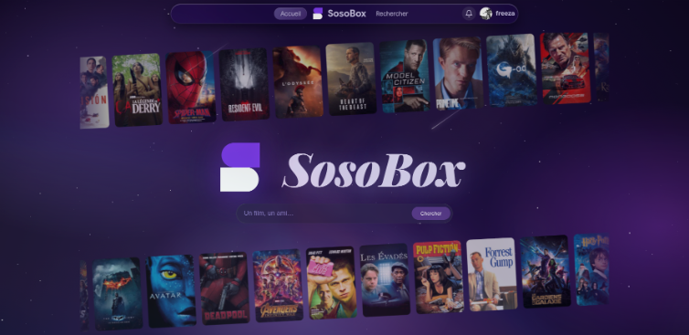
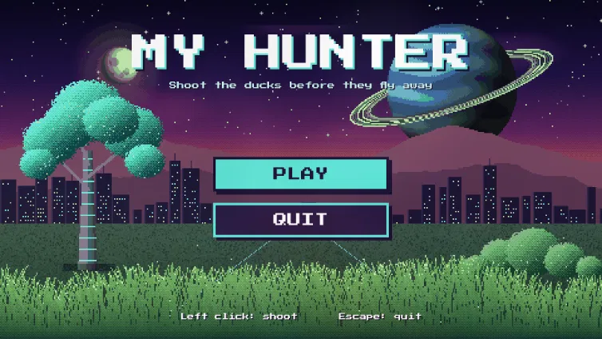
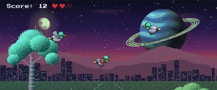

## Salut, moi c'est Tristan

Je suis en première année à Epitech. Je fais surtout du C pour l'école, et à côté j'apprends le web en montant mes propres projets. J'aime bien aussi faire des petits jeux, en C avec la CSFML ou sur Roblox Studio quand j'ai du temps.

Je code sous Arch avec Hyprland.

### Ce sur quoi je bosse

**[SosoBox](https://github.com/Freeza222/SosoBox)** : mon propre Letterboxd. Je note les films que je regarde, j'écris ce que j'en ai pensé et je vois ce que regardent mes potes. Fait en Node/Express avec EJS, SQLite et l'API de TMDB. Il est en ligne ici : [sosobox.duckdns.org](https://sosobox.duckdns.org)

**[My Hunter](https://github.com/Freeza222/My_Hunter)** : un jeu de tir en pixel art, en C avec la CSFML, pour le module G-MUL-100. Des canards traversent le ciel, il faut les descendre avant qu'ils partent.

<table>
  <tr>
    <td width="60%"></td>
    <td width="40%"></td>
  </tr>
</table>

### À l'école

my_ls, setting_up, my_sudo, my_hunter en C, et des projets de maths comme 102architect ou 103cipher (en Python).
